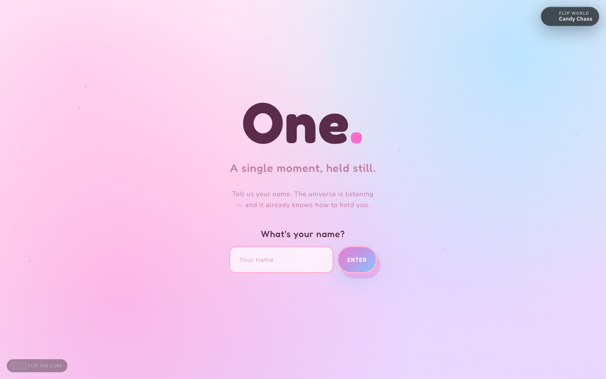
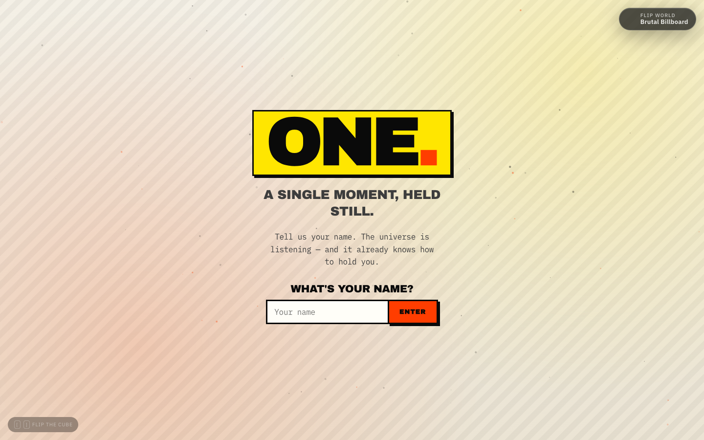
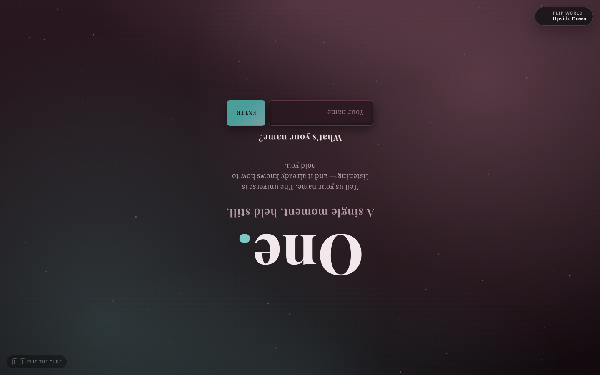
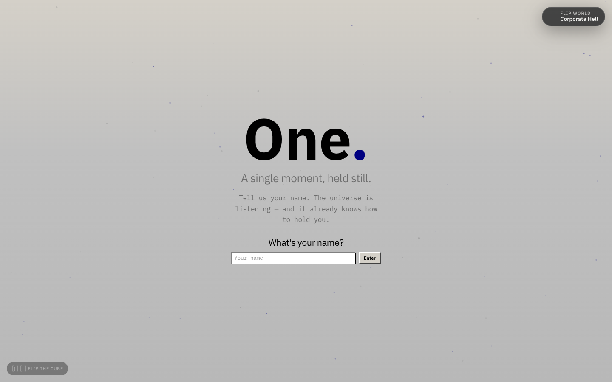
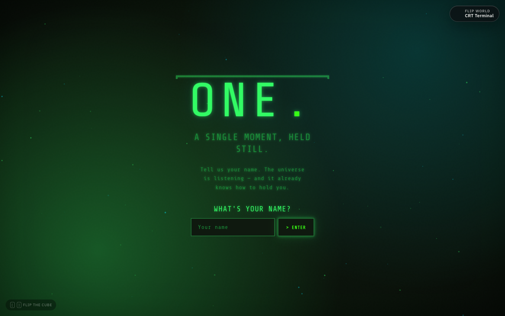
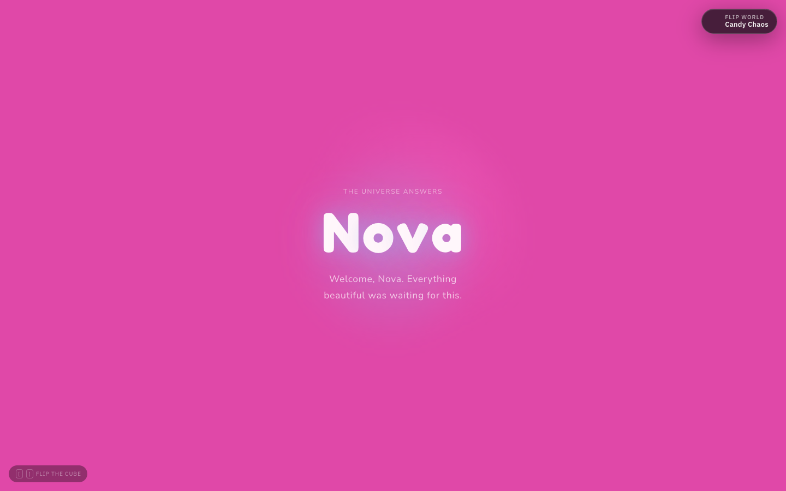

# One

One is a single HTML file. It asks for your name, then answers. The page is also a cube: flip it and the same screen arrives in a different theme. There are five, and each one commits fully.

Open [`index.html`](index.html). There is no build step.



## Themes

The active theme is stored in `localStorage` under `one-theme`. Flip from the button at the top right, or with the keyboard.

| Theme | `one-theme` value | What you get |
| --- | --- | --- |
| Candy Chaos | `candy-chaos` | Rounded type, pastel gradients, a bouncy Enter button |
| Brutal Billboard | `neo-brutal-billboard` | Hard edges, a yellow billboard wordmark, offset shadows |
| Upside Down | `upside-down-world` | The page content rotated 180° |
| Corporate Hell | `corporate-hell` | A cramped, gray, mandatory-training screen |
| CRT Terminal | `crt` | Phosphor green type, scanlines, a glowing prompt |

### Candy Chaos

The theme the page opens on. Soft color, round controls, and a field of drifting particles.


### Brutal Billboard

Type is heavy, corners are square, and the wordmark sits on a yellow block with a hard shadow. Hover states step instead of easing.



### Upside Down

The world inside the cube is rotated. The flip button and the keyboard hint stay outside the cube, so they remain right-side up.



### Corporate Hell

Tight spacing, a flat gray field, and a small beveled Enter button. It looks like a form you were required to complete.



### CRT Terminal

Monospace phosphor type on a dark green tube, with scanlines and a `>` prompt on the button.



## After you press Enter

The name is trimmed, collapsed to single spaces, and capitalized word by word (32 characters max). A ripple expands from the form, then the screen fills with the name one letter at a time and one of four greetings.



## Run it

```bash
open index.html
```

Typefaces load from Google Fonts. Offline, the page uses the fallback stacks already in the CSS (`Nunito`, `Impact`, `Georgia`, `Tahoma`, `ui-monospace`).

To serve it:

```bash
python3 -m http.server
```

Then open `http://127.0.0.1:8000/`.

## Controls

- **Flip world** (top right) advances to the next theme. A horizontal swipe on that button flips either way.
- **`[`** and **`]`** flip the cube. **Alt + Left** and **Alt + Right** do the same. These shortcuts are ignored while the name field is focused.
- **Enter** submits the name.
- With `prefers-reduced-motion`, the cube cuts straight to the next theme, particles stay still, and the name appears without the letter animation.

Everything — theme tokens, the cube transition, and the canvas particles — lives in `index.html`.
